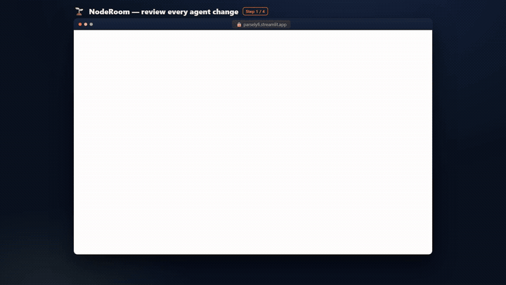
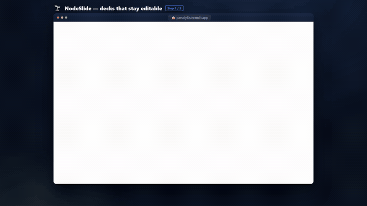

# probe-first

**Research the person before you write to them. Then open short — one verified
recent detail, one open question.**

A skill for Claude Code and a contract for any coding agent. It refuses to draft
outreach until a real research hook exists on that contact, because a template
that invents a plausible opener is a fabrication in the one artifact a stranger
actually reads.

---

## The 26 words that caused this

A CTO sent seven words: *"hey Homen, want to chat?"*

The agent drafted about eighty — a positioning statement, a proof point, two
availability slots. The human deleted it and sent:

> Hi Robert,
>
> Happy to chat. I just saw your demo from a few days ago; I thought that was
> pretty cool!
>
> What are you looking for?

One researched detail the agent had never looked for. One open question. That is
the whole method.

## Why it generalises

- **A short inbound is opening a conversation, not requesting a pitch.**
- **Pitching first surrenders leverage** — it says what you want before you know
  what they want, so they screen you against a slot instead of getting curious.
- **A concrete recent detail proves attention** precisely because it cannot be
  templated.
- **An open question makes them describe their real need,** which is worth more
  than any opener you could have written.

Job search, sales, BD, fundraising, recruiting, partnerships, user research — the
shape holds anywhere a first message is the artifact.

## The gate

```
NO DRAFT — no research hook on this contact.
Look them up first. A generic opener is worse than a late reply.
```

Research is a lookup, not a language task. Ask a model to write an opener without
research and it will produce something plausible and false.

**"No hook found, deprioritise" is a correct answer**, and a good research pass
returns it regularly.

## What deep research actually buys

From one real run across twelve contacts. Every item below traces to an agent
that completed and cited sources:

- **A pivot** that made the obvious opener eighteen months stale — the company
  had changed both its product and its name.
- **A demo that shipped as a product two days later**, which turned a compliment
  into a technical observation.
- **A stated position that contradicted the candidate's strongest evidence** —
  the target had said publicly there is no ground truth for LLM evaluation, while
  holding a patent on evaluation tooling for a nondeterministic system. That
  contradiction was the conversation.
- **A comp claim that did not survive posted ranges** — "up to $300k" held at two
  companies out of eleven; the median was less than half.
- **A better-matched opening posted the same day**, whose bullets described the
  candidate's actual work better than the role being applied to.
- **Three contacts with no hook at all**, correctly reported as such rather than
  papered over.

### And one finding that was not real

The same run produced a specific, checkable, entirely unsourced claim: a second
SEC-registered firm, with a registration date and a filing date. Three research
agents had returned **zero-byte output**, and their claims were recorded anyway.
It reached the `hook` field — the one that composes an outbound message — before
anyone checked.

That is why `source` is required by construction rather than by convention, why a
bare-string hook is refused as `legacy_unsourced_hook`, and why the store contract
says a zero-byte agent result must be recorded as **failed** rather than silently
absorbed. **A gate that checks whether a hook exists does not check whether it is
true.** Both checks are needed, and the second one is the harder half.

## Running in a real product

The gate is not only doctrine — it ships as an executable check in
[Parity Studio](https://github.com/HomenShum/parity-studio), shaped after that repo's existing
`evaluateNodeSlideSessionGrant`: pure, non-mutating, typed reason codes.

```ts
evaluateOutreachHookGate({ contactId, hook, evaluatedAt })
// -> { allowed: false, reasonCode: 'legacy_unsourced_hook',
//      explanation: '...', remedy: 'Re-record it with the URL you actually read.' }
```

Seven reason codes, and each one came from a defect that actually happened:
`no_hook`, `legacy_unsourced_hook`, `source_not_resolvable`, `hook_not_specific`,
`hook_stale`, `invalid_contract`, `allowed`. 12/12 tests, typechecks under
`exactOptionalPropertyTypes`.

Two rules worth stealing outright:

- **Staleness is measured from when the thing happened, not when it was recorded.**
  Recording an old item today does not make it recent; the recipient knows when
  they posted it.
- **`occurredAt: undefined` is allowed, not treated as stale.** Unknown is a
  value. The gate declines to claim an age it does not have.

### The surfaces it guards

NodeRoom — shared workrooms where agent edits stay reviewable. The clip runs the
product's own drills: a stale agent write loses the race, and instead of
overwriting the human it opens a `semantic_rebase` review proposal that a person
approves:



*[Watch with full fidelity →](https://youtu.be/3N7sBxFLFOc)* · 8 steps, 24s,
**exercises 6 of 21 interactive elements (29%)** — the other 15 are the
architecture panel, the mobile wedge, and the live-room entry points.

NodeSlide — decks generated from a brief, reviewable rather than static:



*[Watch with full fidelity →](https://youtu.be/M9cc5Gj1pQE)* · 8 steps, 23s,
**exercises 8 of 91 interactive elements (9%)**. The clip opens the inspector's
Versions, Evidence and Trace tabs, where the product states its own limits:
Evidence checks citation attachment but says plainly it does **not** verify
facts, and Trace reports cost as `not recorded` rather than printing a number it
does not have. Stated rather than implied: a tour that skips 83 controls is
allowed; pretending it didn't is not.

Both produced by [FeatureClipStudio](https://github.com/HomenShum/FeatureClipStudio) — Playwright
capture, Remotion render, ffmpeg two-pass palette. 176 and 128 frames with an
animated cursor, step captions and a zoom-to-focus camera.

The first version of this README carried 2-frame GIFs from an LZW encoder written
by hand, because nobody checked whether a tool for this already existed. It did,
in the same workspace, with ffmpeg already on PATH. **Check before you build** is
the same rule this skill enforces about research — a hand-rolled substitute for
something that already exists is the build-time version of a fabricated hook.

Each capture is gated on a proof selector: if the page does not render, the run
fails rather than emitting a frame, because a screenshot of a blank page looks
like evidence and is not.

## Install

**As a Claude Code skill**

```bash
git clone https://github.com/HomenShum/probe-first ~/.claude/skills/probe-first
```

It loads automatically and triggers on drafting or research requests.

**For any other coding agent**

Point it at `SKILL.md`, or copy `AGENTS.md` into your repo. `references/DOSSIER.md`
is a research schema you can hand to a subagent verbatim; `references/STORE.md` is
a storage contract you can implement against SQLite, Postgres, Convex, or a JSON
file.

## Contents

| File | What it is |
| --- | --- |
| `SKILL.md` | The skill — rules, message shape, research method |
| `AGENTS.md` | Drop-in instructions for non-Claude agents |
| `references/DOSSIER.md` | The research schema, and when to return "no hook" |
| `references/STORE.md` | Contact-store contract: honest staleness, provenance, ranking |

## The one design decision worth copying

**The gate lives on the write path, not in a prompt.**

A rule in a system prompt is a suggestion — it competes with everything else in
context and loses under pressure. A function that returns `NO DRAFT` is a gate.
The same applies to the store's other guarantees: unknown staleness sorts as
urgent *in the comparator*, and confidence is inherited *in the constructor*.

Put the doctrine in code, and it holds on the day you are in a hurry.

## Related

- [before-after-proof](https://github.com/HomenShum/before-after-proof) — capture
  evidence before a change, because a "before" cannot be reconstructed after
- [graph-hop](https://github.com/HomenShum/graph-hop) — consult reasoning that
  lives in ChatGPT threads
- [task-level-guide](https://github.com/HomenShum/task-level-guide) — classify
  work by engineering level

## Licence

MIT
